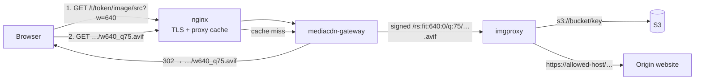

# Architecture

## Request flow

1. **Resolve.** The site renders `…/t/<token>/image/<base64url(source)>?w=640`. The gateway checks the token and the source against the tenant's allow-list, snaps `w` to an allowed width and answers with a `302` to the canonical URL for the format the browser accepts.
2. **Serve.** The canonical URL (`…/w640_q75.avif`) is checked again, then the gateway builds an imgproxy path, signs it with the imgproxy key/salt and fetches the result. The response gets an immutable `Cache-Control` and a SHA-256 ETag.
3. **Cache.** nginx caches canonical responses (200 for 30 days, 403/404 for a minute). The redirect itself is `private` and never shared-cached, because it varies by `Accept`.

## Why a gateway in front of imgproxy

| | imgproxy alone | with the gateway |
|---|---|---|
| Who signs URLs | every site, so every site holds the imgproxy key | only the gateway |
| What a site may load | anything the key can sign | its own domains/buckets only |
| Revoking a site | rotate the key for everyone | `"enabled": false` + reload |
| Format negotiation | inside one URL (`Vary: Accept`) | separate canonical URL per format, easy to cache |
| Next.js `<Image>` | needs a server-side signing route | plain custom loader, no secrets |

## Security model

- **Tokens are identifiers, not secrets.** They appear in public HTML. Protection comes from the allow-list: a token only reaches its own sources, so a leaked token can only re-serve images that site already publishes.
- **Source checks happen before signing.** `http(s)` hosts must match a tenant domain exactly or a `*.domain` wildcard (`cdn.example.com.evil.com` does not match `*.example.com`). `s3` sources must name an allowed bucket. Any other scheme is rejected.
- **SSRF** is limited by the allow-list. imgproxy refuses loopback and link-local source addresses by default; private addresses are allowed by default, so set `IMGPROXY_ALLOW_PRIVATE_SOURCE_ADDRESSES=false` unless a tenant really needs an internal `https://` source (see [deployment.md](deployment.md)).
- **imgproxy is not exposed directly** for tenant traffic; only requests signed by the gateway (or other key holders) are accepted by imgproxy.
- Token comparison uses constant-time equality.

## Limits

- Output capped at 32 MiB per image (`502` above that).
- Upstream timeout 30 s.
- Widths are limited to 16 values, so the number of variants per image (and the cache size) is bounded: 16 widths × 4 formats × the qualities in use.
